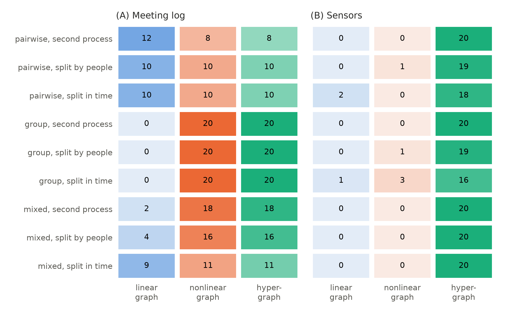

# Supplementary File S2: three ways of holding out data

Rommens et al. (arXiv 2609.26031v2, p. 16, item iii) recommend reporting "predictive log
loss on held-out trajectories or interventions". The main text holds out a second
spreading process on the same recorded contacts, started from different first adopters.
The models are fitted to the first process and scored on the second.

Two other ways of holding out data are possible when only one process is recorded:

- split by people: fit on a random half of the people over the whole time, and score the
  other half;
- split in time: fit on the adoptions before the median adoption time, and score the
  adoptions after it.

<picture>
  <source media="(prefers-color-scheme: dark)"
          srcset="outputs/figures/holdout_pilot_dark.png">
  
</picture>

Runs won by each model, out of 20, by held-out misfit, in the setting described in the
main text. Each row is a kind of spreading (the pairwise, group or mixed world) and a
way of holding out data. Left: meeting log. Right: sensors. A tied run counts for each
model in the tie, and models whose scores are equal up to numerical error tie. On the
log, the nonlinear graph model and the hypergraph model make identical predictions
(File S1), so they tie in every run that the linear graph model does not win alone.
Source: `just figure`, outputs/runs/pilot.

On the log, the second process and the split by people agree: in the pairwise world the
linear graph model wins alone in 12 and 10 runs, and in the other two worlds in at most
4. The split in time picks the linear model more often in the mixed world (9 runs,
against 2 with the second process), where the linear model is wrong. In the group world
all three ways give the same result.

On the sensors, the hypergraph model wins at least 16 of 20 runs in every world under
all three ways of holding out data.