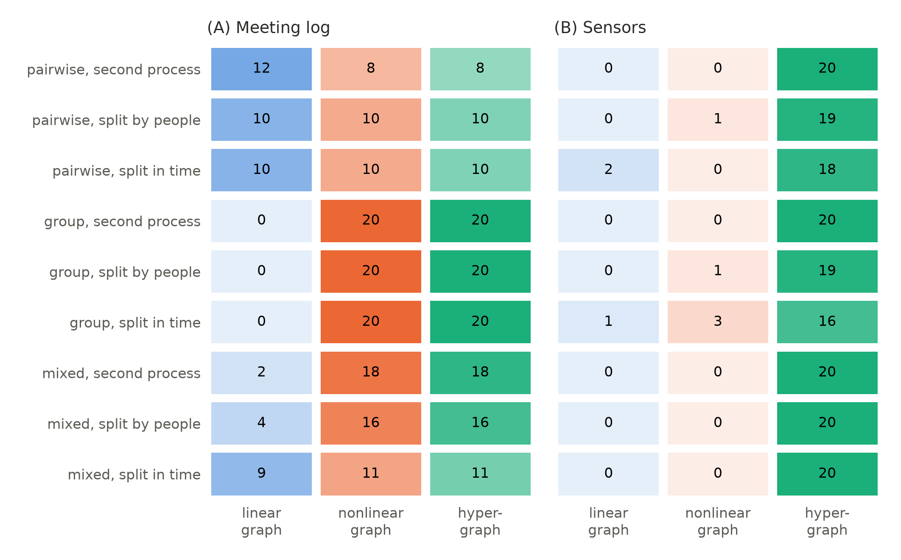

# Supplementary File S2: three ways of holding out data

Rommens et al. (2026) recommend reporting how well a model predicts held-out data. The
main text holds out a second spreading process on the same recorded contacts, with its
own first adopters, drawn independently of those of the first. The models are fitted to
the first process and scored on the second.

Two other ways of holding out data are possible when only one process is recorded:

- split by people: keep each person with probability one half, fit on the people kept
  over the whole time, and score the others;
- split in time: fit on the adoptions before the median adoption time, and score the
  adoptions after it.

<picture>
  <source media="(prefers-color-scheme: dark)"
          srcset="outputs/figures/figure_s2_dark.png">
  
</picture>

Runs won by each model, out of 20, by held-out misfit, in the setting described in the
main text. Each row is a kind of spreading (the pairwise, group or mixed world) and a
way of holding out data. (A) Meeting log. (B) Sensors. A tied run counts for each model
in the tie, and models whose scores are equal up to numerical error tie. On the log,
each person is in one gathering at a time, so the people in contact with a person are
exactly the members of that person's gathering, and the nonlinear graph model and the
hypergraph model make identical predictions. They therefore tie in every run that the
linear graph model does not win alone.

On the log, the second process and the split by people agree: in the pairwise world the
linear graph model wins alone in 12 and 10 runs, and in the other two worlds in at most
4. The split in time picks the linear model more often in the mixed world (9 runs,
against 2 with the second process), where the linear model is wrong. In the group world
all three ways give the same result.

On the sensors, the hypergraph model wins at least 16 of 20 runs in every world under
all three ways of holding out data.